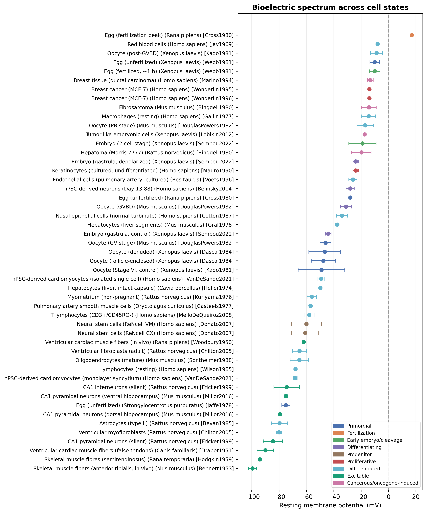

# Bioelectric Spectrum Dataset

Curated compilation of resting membrane potential (Vm) measurements across cell types, developmental stages, and functional states. This dataset accompanies the paper "Bioelectric States and Cellular Phenotype: A Review and Compiled Dataset of Resting Membrane Potentials" submitted to _Bioelectricity_.



## Dataset

The compilation includes 49 entries spanning eleven species and eleven functional state categories, from unfertilised oocytes to terminally differentiated excitable tissues. Values range from +17 mV (fertilisation peak) to −99.4 mV (skeletal muscle in vivo).

## Requirements

- Python 3.x
- Required Python packages (see requirements.txt)

## Installation

Install the required Python packages:

```
pip install -r requirements.txt
```

## Usage

To regenerate the figure and summary statistics from the dataset:

```
python analysis.py --csv dataset.csv --out .
```

## Command-Line Arguments

- `--csv`: Path to the CSV file with membrane potential data (default: dataset.csv).
- `--out`: Output directory for generated files (default: current directory).

## Output

The script generates three output files:

1. `bioelectricspectrum.png`: Visualisation of Vm values ordered from most depolarised to most hyperpolarised.
2. `summarystats.csv`: Summary statistics (n, mean, SD) by functional state.
3. `summarystatstable.tex`: LaTeX table of summary statistics.

## Files

| File                      | Description                                                                              |
| ------------------------- | ---------------------------------------------------------------------------------------- |
| `dataset.csv`             | Curated Vm measurements with cell type, species, functional state, method, and reference |
| `analysis.py`             | Python script for generating figures and statistics                                      |
| `bioelectricspectrum.png` | Main figure showing bioelectric spectrum across cell states                              |
| `summarystats.csv`        | Summary statistics grouped by functional state                                           |

## Citation

If using this code or results, please cite:

```bibtex
@article{chudzik2025bioelectric,
  title={Bioelectric States and Cellular Phenotype: A Review and Compiled Dataset of Resting Membrane Potentials},
  year={2025}
}
```

## Reuse and provenance

The MIT License in `LICENSE-CODE` applies to the original analysis script (`analysis.py`) only. It does not relicense `dataset.csv`, which compiles measurements reported by the cited publications, or the generated figure and summary artifacts. Check the original sources and their terms before redistributing the data. The paper's publication and citation metadata should be checked before treating the provisional BibTeX entry above as a final journal citation.
